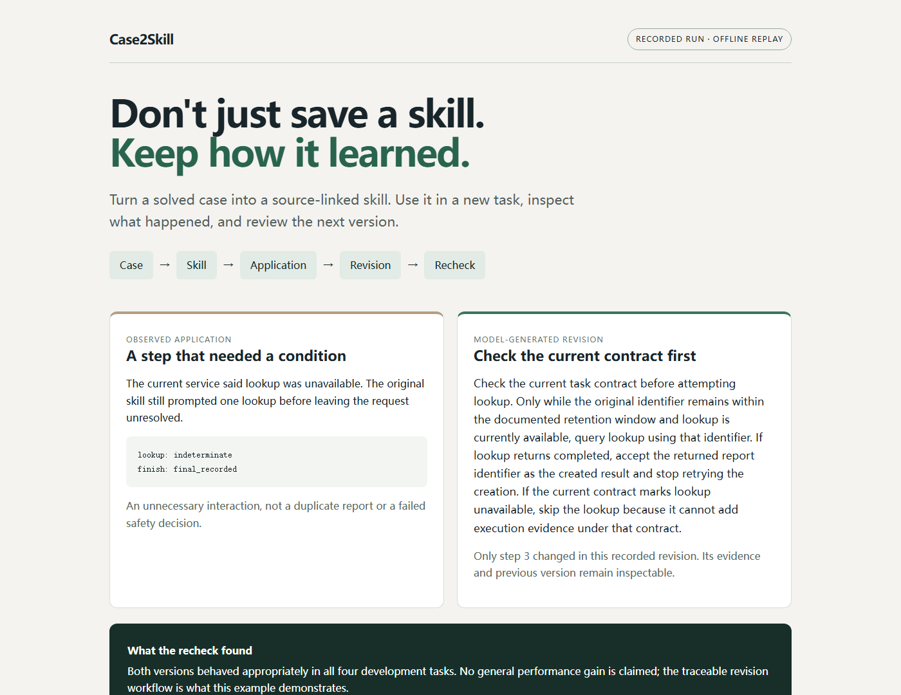

# Case2Skill

**Turn solved cases into skills you can inspect, test, and improve.**

[中文说明](README.zh-CN.md) · [CLI reference](docs/CLI.md) · [Evidence](docs/EVIDENCE.md) · [Contributing](CONTRIBUTING.md)

You fixed a problem. Your agent can summarize the fix—but what should it carry into the next task? Case2Skill keeps the instructions, the conditions that make them useful, the supporting evidence, and the history of later corrections together.

```text
solved case → source-linked skill → new task → feedback → revised skill → recheck
```



## Try it without a model account

Download or clone this repository, enter its directory, and use **Node.js 24.13 or newer**:

```sh
npm run demo
```

Open the `index.html` path printed in the terminal. This replays a **saved model-generated revision**, checks the recorded actions against the local simulator, and shows the before/after skill. It makes no model calls, needs no API key, and does not install dependencies.

The story is concrete: a skill led to an unnecessary lookup when the current service said lookup was unavailable. A later version changed one step. The recheck preserved correct behavior; it did not establish a general performance gain.

For a separate, freshly executed deterministic control experiment:

```sh
npm run controls
npm test
```

## Bring your own solved case

```sh
node src/cli.ts init --out work/my-case
```

Edit the generated Markdown files to describe the problem, correction, relevant rules and remaining uncertainty. Declare any actual execution logs in `case.json`. Then use an authenticated, compatible **Codex CLI**:

```sh
node src/cli.ts doctor
node src/cli.ts learn work/my-case --out work/learn --model-data-approved
node src/cli.ts inspect work/learn/candidate
node src/cli.ts export work/learn/candidate --candidate --out work/exported-skill
```

`--model-data-approved` permits sending those selected files through your existing Codex account. Live commands consume model/account usage. An optional `--model MODEL_ID` selects a model your account actually supports; Case2Skill does not hardcode a product name.

Review the exported skill before putting it into an agent's skill directory. Exporting does not install it or grant execution permissions.

## Improve a skill when the evidence changes

Add the new evidence to a copy of your case pack, keeping its case ID and the earlier files needed by existing references:

```sh
node src/cli.ts refine work/updated-case work/learn/candidate --out work/refined --model-data-approved
node src/cli.ts diff work/learn/candidate work/refined/candidate
```

Each revision has a new content hash and an inspectable parent/child diff. Previous test results and human approval are not silently inherited.

The bundled [lookup-retention case](examples/lookup-retention/README.md) illustrates a project-specific correction: an expired retry key does not necessarily mean an accepted report can no longer be looked up. It includes a real model-generated candidate and a recorded local task check.

## What is inside a skill?

```text
candidate/
  SKILL.md                 # concise instructions for the agent
  lesson.json              # structured source of truth
  manifest.json            # content and source fingerprints
  references/evidence.md   # exact supporting source ranges
```

Notes distinguish **observed**, **documented**, and **inferred** claims. Empty boundaries stay empty rather than being invented to fill a template. Reference checks establish that the cited material exists; human review establishes whether it really supports the instruction.

## Scope of version 0.1

| Capability | Current scope |
|---|---|
| Learn, compile, inspect, refine, export | Your explicitly selected local text cases |
| Recorded replay | Bundled, privacy-filtered development example; offline |
| Live task evaluation | Built-in report-service simulator, identical tools across arms |
| Automatic feedback diagnosis | One tested rule: lookup attempted despite documented unavailability |
| Native skill-loading check | Explicit project-level Codex skill selection |

This is a small developer tool, not a new agent runtime or a claim of autonomous learning. Arbitrary GitHub ingestion, arbitrary task evaluators and additional live agent backends are future contributions. A normal skill generated from the same full case remains a first-class comparison; current development trials have not shown a general success-rate advantage. [Read the evidence and its boundaries.](docs/EVIDENCE.md)

## Develop

```sh
npm ci --ignore-scripts
npm run validate
npm run release:check
```

Runtime dependencies: **zero**. TypeScript and Node types are development-only. CI checks Windows, Linux and macOS without model credentials; hosted CI results become available after the repository is pushed. Live model tests remain opt-in. See [architecture](docs/ARCHITECTURE.md) and [CLI documentation](docs/CLI.md).

## Share a useful case

A good contribution contains a solved problem, inspectable evidence, and a meaningful change of conditions—not a contrived weak baseline. Use the example-case issue template or send a small pull request. Never submit private conversations, source material you cannot redistribute, or credentials.

## License and safety

[MIT](LICENSE). Imported case material retains its original rights. The repository's examples are independently authored simulations and selected model-run records, described in [NOTICE](NOTICE.md). Candidate skills are text, not trusted programs. Read [SECURITY](SECURITY.md) before processing private material or installing a generated skill.